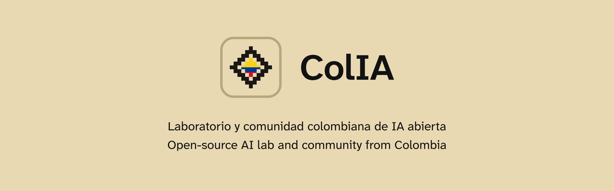

<a href="#español">Español</a> · <a href="#english">English</a>

## Español

ColIA es un laboratorio y una comunidad colombiana de IA abierta, donde se aprende construyendo y se demuestra que en Latinoamérica también se crea.

### Qué hacemos

| Proyecto | Qué es | Estado |
|---|---|---|
| **ColIA-Local** | Una app que pone modelos de IA en tu equipo, sin cuenta y sin nube | En desarrollo |
| **Sibundoy** | Un modelo pequeño que traduce de inglés a español | En preparación, en [Hugging Face](https://huggingface.co/colia-labs) |

### Cómo trabajamos

- **Abierto.** El código, los modelos y las recetas se publican con licencia abierta.
- **Medido.** Cada afirmación lleva cifras, medidas en hardware modesto.
- **Bilingüe.** Todo sale en español y en inglés. El español es nativo, no una traducción.
- **Local.** Lo que hacemos funciona en tu equipo, sin depender de una nube.
- **Comunidad.** Quien quiera aprender, explorar o aportar es bienvenido, sepa mucho o poco.

### Únete

No hace falta ser experto. Aquí aprendemos haciendo y en público.

- **Habla con nosotros** en [Discussions](https://github.com/orgs/colia-labs/discussions): preguntas, ideas o lo que estés construyendo.
- **Aporta** siguiendo la [guía para aportar](https://github.com/colia-labs/.github/blob/main/CONTRIBUTING.md).
- **Lee las [normas de convivencia](https://github.com/colia-labs/.github/blob/main/CODE_OF_CONDUCT.md)**: son cortas.
- **Escríbenos** a hola@colia.org.

Pronto abriremos también un Discord.

## English

ColIA is an open-source AI lab and community from Colombia. We learn by building, and show that Latin America creates too.

### What we make

| Project | What it is | Status |
|---|---|---|
| **ColIA-Local** | An app that runs AI models on your computer, with no account and no cloud | In development |
| **Sibundoy** | A small model that translates English into Spanish | In preparation, on [Hugging Face](https://huggingface.co/colia-labs) |

### How we work

- **Open.** Code, models and recipes are published under open licenses.
- **Measured.** Every claim comes with numbers, measured on modest hardware.
- **Bilingual.** Everything ships in Spanish and English. The Spanish is native, not a translation.
- **Local.** What we make runs on your computer, without depending on a cloud.
- **Community.** Anyone who wants to learn, explore or contribute is welcome, whatever they know.

### Join us

You don't need to be an expert. Here we learn by doing, in the open.

- **Talk to us** in [Discussions](https://github.com/orgs/colia-labs/discussions): questions, ideas or whatever you're building.
- **Contribute** by following the [contributing guide](https://github.com/colia-labs/.github/blob/main/CONTRIBUTING.md).
- **Read the [code of conduct](https://github.com/colia-labs/.github/blob/main/CODE_OF_CONDUCT.md)**: it's short.
- **Write to us** at hola@colia.org.

A Discord is coming soon.
